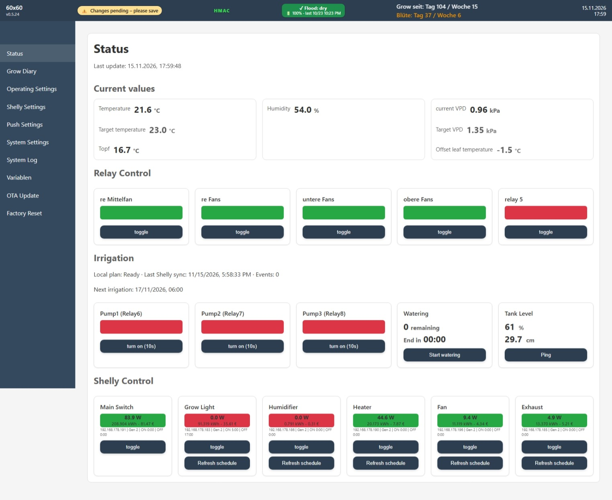
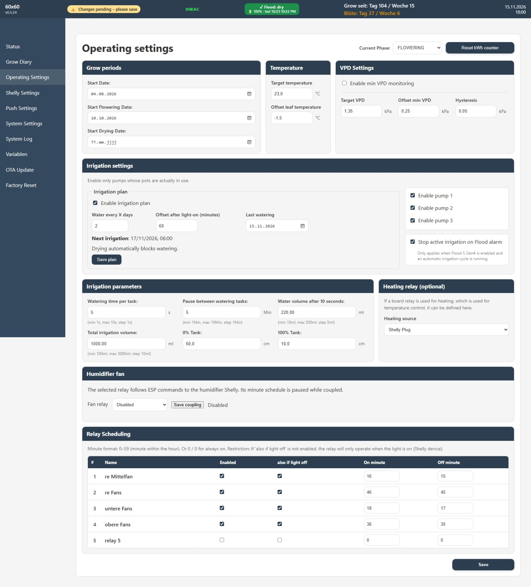
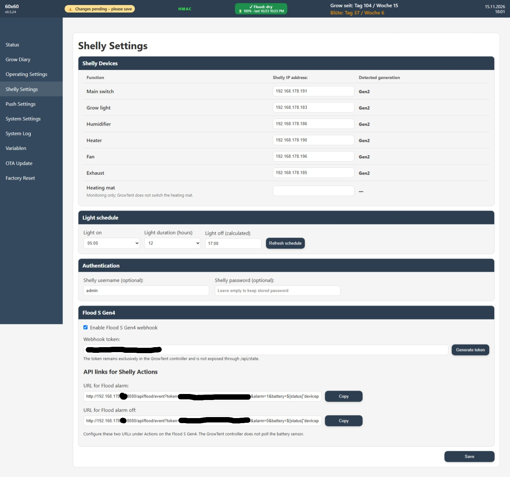
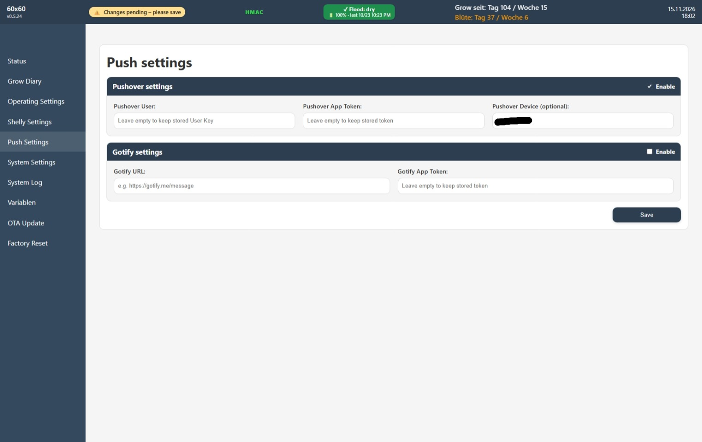
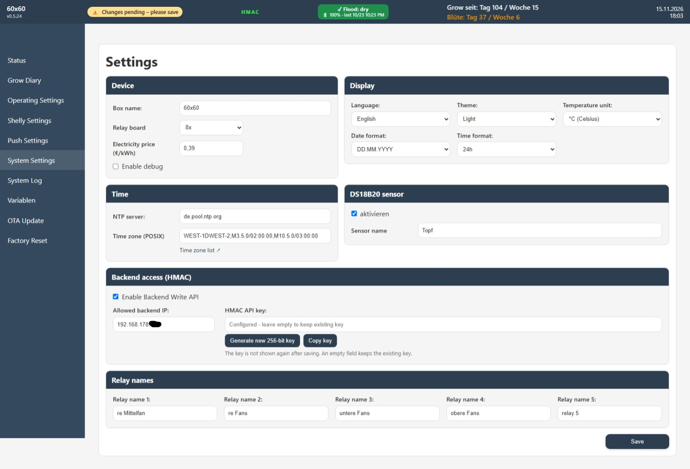

# GrowTent

ESP32 NodeMCU-32S firmware for climate monitoring, VPD automation, irrigation and Shelly integration. For the Waveshare six-channel ESP32-S3 board, use [GrowTent-S3](https://github.com/syschelle/GrowTent-S3).

Pair it with the [GrowTent Backend](https://github.com/syschelle/growtent-backend) for centralized history and multi-tent monitoring.

## Hardware and relay assignment

BME280 at I2C address `0x76`, optional DS18B20 on GPIO4, and HC-SR04 with TRIG GPIO16 / ECHO GPIO17.

| Relay | GPIO | Role |
| ---: | ---: | --- |
| 1 | 32 | General relay |
| 2 | 33 | General relay |
| 3 | 25 | General relay |
| 4 | 26 | General relay |
| 5 | 27 | General relay (8-channel configuration) |
| 6 | 14 | Pump 1 |
| 7 | 12 | Pump 2 |
| 8 | 13 | Pump 3 |

Select a 4- or 8-relay board in System Settings. Only relays 1–4 are active in the 4-relay configuration; pump irrigation requires eight channels.

## Features

- German/English responsive web interface, light/dark themes and configurable date, time and temperature display.
- BME280 climate measurement with adaptive smoothing, leaf-temperature offset and target-based VPD control.
- Optional named DS18B20 temperature sensor and HC-SR04 tank-level measurement.
- Minute schedules for general relays, optionally restricted to light-on periods.
- Temperature-controlled heating through a local relay or Shelly, with predictive trend handling.
- Shelly main power, light, humidifier, heater, fan and exhaust integration; heating-mat monitoring without switching it.
- Power, energy and cost display with configurable electricity price and energy-counter reset.
- ESP-owned irrigation plan, individual pump enable switches, sequential watering and manual pump tests.
- Shelly Flood S Gen4 webhooks, watering start interlock and optional active-cycle abort.
- Humidifier fan relay coupling with cached Shelly Auto-Off timing.
- Pushover/Gotify notifications, local Grow Diary in LittleFS, system log and GitHub OTA updates.

## Web interface and screenshots

Open `http://<esp-ip>:8080/`. The application and its assets are embedded in the firmware; no separate web hosting is required. Status polling runs on the Status page, log polling on System Log; settings pages stay static while being edited.

The screenshots show a classic ESP32 with an eight-relay configuration. Names, device addresses and readings are examples; sensitive fields were redacted in the supplied images.

### Status

Current climate and target values, named DS18B20 measurement, relay controls, pump states, tank level, local-plan readiness, next irrigation and Shelly power/energy/cost telemetry. The header shows grow/flowering age, Flood status and HMAC configuration status.



### Operating settings

Grow/flowering/drying dates and phase, temperature and VPD targets, leaf offset, minimum-VPD monitoring, irrigation interval and offset after light-on, last-watering date, enabled pumps, pulse/pause/volume calibration, heating source, humidifier fan coupling and relay minute schedules.

Use **Save plan** for the irrigation plan and **Save coupling** for the fan assignment. Other operating settings use their page save action.



### Shelly settings

Seven device roles with IP addresses and detected generation, light-on time and duration, shared optional credentials, and Flood webhook setup. The heating mat is monitoring-only. Flood events are pushed by the battery sensor; the ESP does not poll it.



### Push settings

Pushover and Gotify have separate permanently visible provider sections and enable switches. Stored credentials are write-only; leaving a secret field empty keeps its saved value. Notification payloads preserve UTF-8 and special characters.



### System settings

Six open cards group Device, Display, Time, DS18B20 sensor, Backend access (HMAC), and Relay names. Configure box name, electricity price, language/theme, units, date/time format, NTP/POSIX timezone, sensor name and backend access here.



Additional pages provide the Grow Diary, System Log, variable diagnostics, OTA updates and Factory Reset.

## Climate control and measurement freshness

VPD uses air temperature, relative humidity and the configured leaf-temperature offset. With `svp(T) = 0.6107 × 10^(7.5 × T / (237.3 + T))` in kPa:

```text
leafTemperature = airTemperature + leafOffset
VPD = max(0, svp(leafTemperature) - RH / 100 × svp(airTemperature))
```

Adaptive smoothing stabilizes temperature/humidity. The control path has an additional dedicated alpha-0.10 filter; raw VPD calculation never advances that filter. Consequently a reference calculated from displayed values can differ from the ESP control value.

Internal calculations, stored temperatures and API values remain Celsius-based. Fahrenheit conversion applies only to browser display/input, including correct conversion of temperature differences.

Invalid climate readings immediately block heater/humidifier ON commands; readings without fresh BME data expire after 30 seconds. Invalid/stale temperature, humidity and VPD become JSON `null`. Climate diagnostics expose `sensors.climate.fresh`, `.status` and `.ageMs`. Fault handling retries OFF commands through the responsible runtime workers; normal control resumes after valid measurements return.

Shelly status failures immediately invalidate the affected reading; otherwise it expires after 60 seconds without a successful status read. The UI shows **Unknown** rather than OFF, and switch/power/energy/cost fields become `null`. Each role exposes `cur.shelly.<role>.fresh` and `.ageMs`. A switch acknowledgement does not renew telemetry freshness.

## Local irrigation and backend integration

The ESP executes the automatic plan. Configure an interval in calendar days, an offset after the light Shelly's scheduled ON time, and known last-watering history. The plan is disabled by default. Disable independent backend scheduling before enabling it.

- Light schedules are refreshed at startup, on phase changes and hourly; supported Gen1 schedules and Gen2/3 `Schedule.List` jobs provide the time source.
- The ESP calculates the next run; the backend displays the signed ESP forecast instead of deriving another schedule. Missing/blocked forecasts include a reason.
- Known watering history may be imported from the backend; it is not estimated, cleared or moved backwards.
- Enabled pumps run sequentially with shared volume/calibration settings and no pump overlap. Disabled pumps and their manual tests are skipped/rejected.
- Drying blocks full watering cycles. Dedicated calibration pulses retain their separate behavior.
- Valid clock, verified storage, event capacity and physical interlocks are required for full cycles. Interrupted or missed scheduled occurrences are not replayed after reboot.
- Durable command identities make signed backend manual starts idempotent across retries. A `202 Accepted` only acknowledges queuing; check the matching result.
- The durable event stream supports backend notification handling for scheduled and full manual cycles. Calibration pulses remain separate.

See [IRRIGATION_PLAN_API.md](IRRIGATION_PLAN_API.md) for the signed protocol, schedule support, event acknowledgements, recovery rules and next-run status fields.

## Humidifier fan coupling

Assign a permitted general relay under **Operating settings → Humidifier fan**. It follows successful ESP-origin commands to the configured humidifier Shelly using its cached Auto-Off duration. The cache refreshes on assignment/startup and hourly. Pumps and the active local heater cannot be selected.

While coupled, independent relay controls and minute scheduling are unavailable; saved minute values are retained and resume when coupling is disabled. Direct commands from another Shelly client are not mirrored. See [HUMIDIFIER_FAN.md](HUMIDIFIER_FAN.md) for timing and failure behavior.

## API and access boundary

The normal dashboard/API uses **ESPAsyncWebServer on TCP/8080**. TCP/80 and captive DNS are reserved for Wi-Fi provisioning and stop after normal STA connectivity returns. Credentials are tested before replacing stored Wi-Fi settings.

| Method | Endpoint | Purpose |
| --- | --- | --- |
| GET | `/api/state` | Primary state and diagnostics |
| GET | `/api/stats`, `/api/async/health` | Compatibility telemetry and health |
| PATCH | `/api/backend/grow-profile` | Narrow authenticated grow-profile update |
| POST | `/api/backend/irrigation-start` | Signed idempotent manual full-cycle request |
| GET | `/api/watering/state` | Irrigation state |
| POST | `/startWatering`, `/toggleWatering`, `/pingTank` | Local watering/tank actions |
| GET | `/api/diary/list`, `/api/diary.csv`, `/api/fs/status` | Diary and storage reads |
| POST | `/api/diary/add`, `/api/diary/update`, `/api/diary/delete` | Queued diary changes |
| GET | `/api/storage/action-status`, `/api/shelly/action-status` | Queued operation results |
| GET | `/api/logbuffer` | System log |
| GET | `/api/ota/check`, `/api/ota/check-status` | Update discovery/result |
| POST / GET | `/api/ota/update`, `/api/ota/update-status` | Install update/read result |
| GET / POST | `/api/flood/event` | Token-protected Flood webhook |

Async callbacks queue hardware, network, storage and restart work for the main loop or responsible task. Follow operation status rather than treating an accepted HTTP request as proof of a physical action. Exact route schemas and board-specific relay restrictions are defined in `src/main.cpp`.

Backend writes are disabled by default. Enabling them requires an exact allowed backend IPv4 address and a 256-bit secret stored as 64 hexadecimal characters. Requests use HMAC-SHA256 over the exact body bytes, timestamp validation (±60 seconds) and replay-protected nonces. The grow-profile endpoint permits only target temperature/VPD, flowering/drying dates and phase, with date/phase consistency checks.

Secrets are not exposed by `/api/state`. Stored HMAC, notification and Shelly credentials are write-only; the Flood token remains available locally for configuring webhook URLs. The local dashboard operates within a trusted-LAN boundary; enabling backend HMAC does not authenticate every dashboard route. See [SECURITY.md](SECURITY.md).

## Storage and defaults

Configuration is stored in Preferences/NVS; the Grow Diary is stored in LittleFS. LittleFS is not automatically formatted during boot or OTA. Use the explicit repair/clear action if needed, understanding that formatting removes diary data.

- Setup AP: `new growtent`, password `GT-12$34`
- Default NTP server: `de.pool.ntp.org`; configurable POSIX timezone
- Default display: German, light theme, Celsius, 24-hour time
- BME280 address: `0x76`

## Build and OTA

Dependencies and board settings are maintained in [platformio.ini](platformio.ini). Install PlatformIO, then:

```bash
pio run -e nodemcu-32s
pio run -e nodemcu-32s -t upload
```

For first installation, upload through USB. The build output is `.pio/build/nodemcu-32s/firmware.bin`.

OTA downloads `firmware.bin` from this repository's [latest GitHub release](https://github.com/syschelle/GrowTent/releases/latest). Classic ESP32 and ESP32-S3 have separate firmware channels; use the channel matching the hardware.

Branch/PR workflows validate builds without publishing. A `v*` tag triggers the release workflow, building the board-specific environment and publishing `firmware.bin` and `manifest.json`, with the matching `RELEASE_NOTES_<tag>.md` as the release/OTA changelog.

## Testing and troubleshooting

See [TESTING.md](TESTING.md) for checks, results and open hardware validation. Hardware-dependent checks remain open where documented; feature availability does not imply those checks passed.

- Dashboard unavailable: use port `8080`; check STA connection or the setup AP.
- BME280 missing: check I2C wiring, power and address `0x76`.
- DS18B20 unavailable: check sensor enable setting, GPIO4 and wiring.
- Unknown climate/Shelly values: inspect freshness diagnostics, device connectivity and System Log.
- No next irrigation: inspect plan readiness, clock, phase, pump enable flags, Flood state and Shelly schedule cache.
- Relay problems: verify the board-specific GPIO mapping and reserved pump roles.
- OTA issues: use `tests/test_ota_transport.sh`; transport issues: `tests/test_async_transport_stress.sh`.

The hardware regression script `tests/test_async_webserver.sh` includes configuration/action tests and is not read-only. Run such checks only on a suitable test controller. No hardware behavior is verified merely by a documentation update.

## Project guide and release information

| Path | Contents |
| --- | --- |
| `src/main.cpp` | Initialization, Async routes and main-loop handoffs |
| `src/function.h`, `src/runtime.h` | Control/API helpers, settings and rendering |
| `src/index_html.h`, `src/java_script.h`, `src/style_css.h` | Embedded web interface |
| `src/task_Check_Sensor.h`, `src/vpd_calculation.h` | Sensor/control task and VPD calculation |
| `src/task_CheckShellyStatus.h`, `src/task_Watering.h` | Shelly and irrigation tasks |
| `src/ota.cpp`, `src/ota.h` | GitHub OTA handling |
| `docs/images/` | README screenshots |
| `tests/`, `scripts/` | Regression diagnostics and repository checks |

Release-specific changes belong in the root `RELEASE_NOTES_*.md` file and [GitHub Releases](https://github.com/syschelle/GrowTent/releases). The repository keeps one current release-notes file; historical notes remain in Git history and published releases. Run `python scripts/check_release_notes.py` before pushing.

## License

Apache License 2.0. See [LICENSE](LICENSE).
